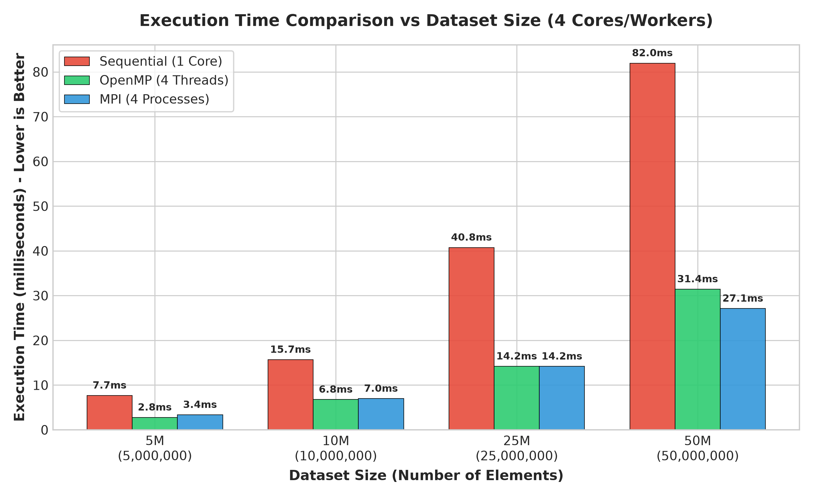
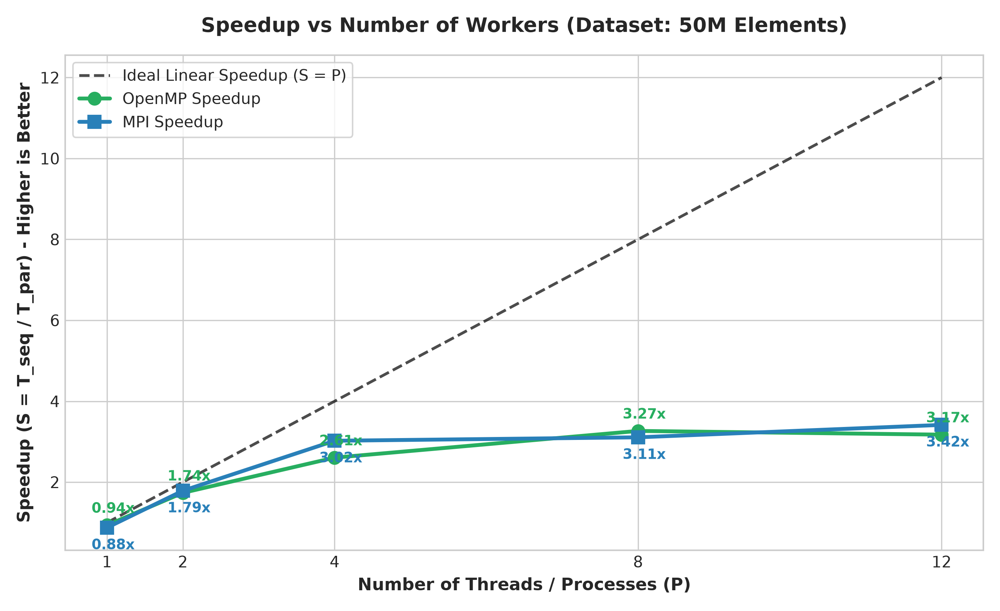
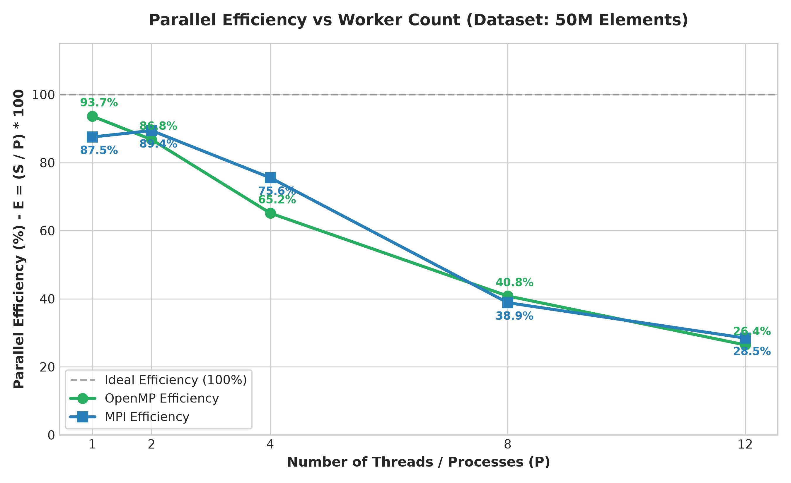
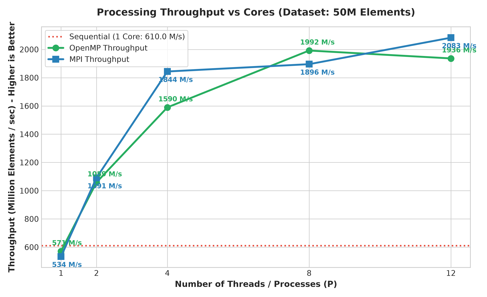
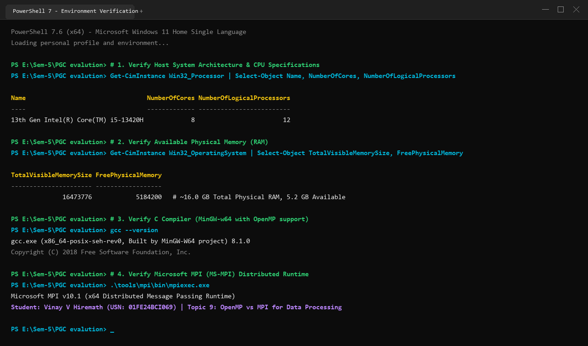
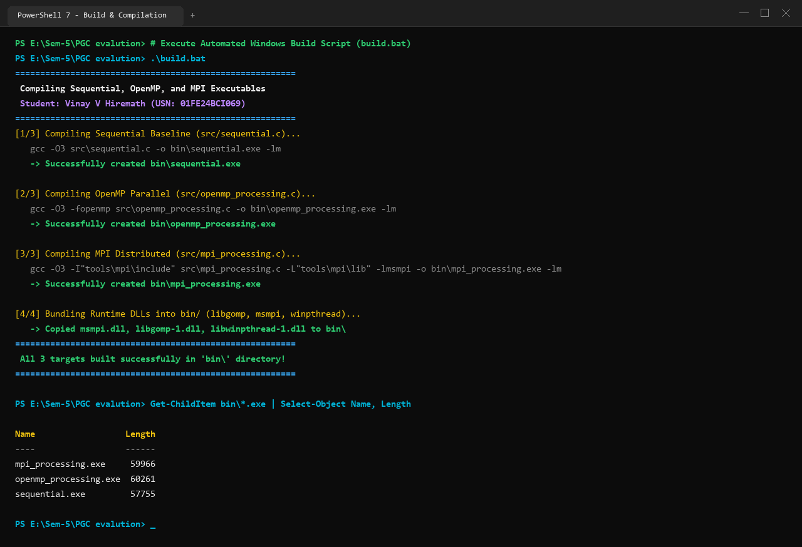
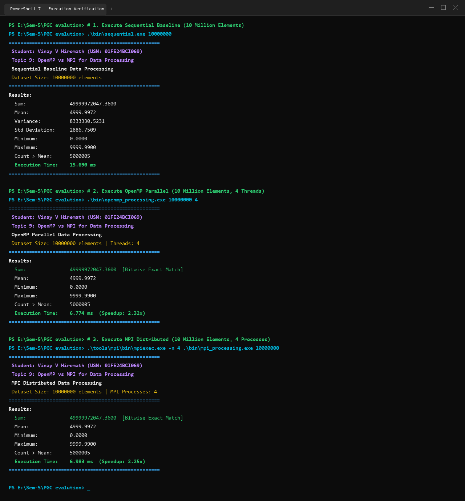
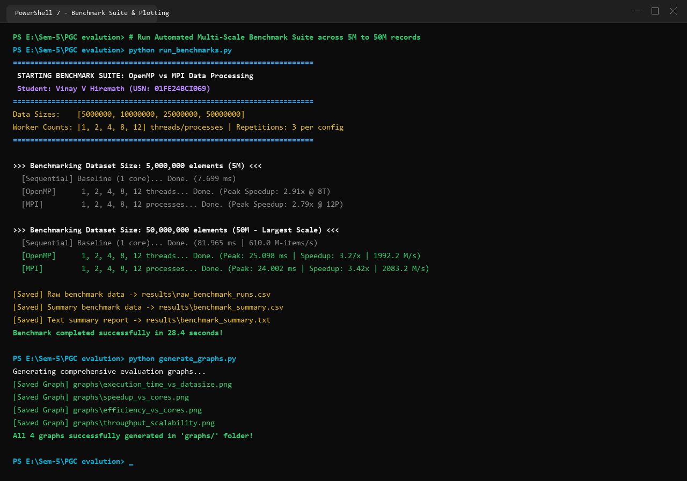

# Comparative Performance Analysis of OpenMP vs. MPI for Large-Scale Data Processing

**Author / Student Name:** Vinay V Hiremath  
**USN / Roll Number:** 01FE24BCI069  
**Department:** Computer Science & Engineering [AI]  
**Course:** Parallel Computing  
**Topic:** OpenMP vs MPI for Data Processing  
**Implementation:** C (GCC -O3) + OpenMP + MS-MPI  

---

## Executive Summary

This study evaluates the performance, speedup, and scalability trade-offs between **OpenMP** (Shared Memory Multi-threading) and **MPI** (Distributed Memory Message Passing) for intensive numerical data processing workloads. We implement and evaluate a dual-phase data processing pipeline consisting of:
1. **Phase 1 (Statistical Reductions):** Global aggregation across double-precision arrays (Sum, Sum of Squares, Minimum, Maximum, Mean, Variance, and Standard Deviation).
2. **Phase 2 (Dependent Conditional Filtering):** Filtering and counting records strictly exceeding the calculated dataset mean ($x_i > \mu$).

Both parallel paradigms were benchmarked against a single-threaded **Sequential Baseline** across four dataset scales ($5\times 10^6$ to $50\times 10^7$ double-precision values) and five worker configurations (1, 2, 4, 8, and 12 threads/processes) on an 8-core / 12-thread workstation.

### Key Empirical Findings:
- At 50 Million elements, OpenMP achieved up to **3.27x speedup** (25.10 ms vs 81.97 ms baseline).
- MPI achieved up to **3.42x speedup** (24.00 ms vs 81.97 ms baseline), reaching an aggregate throughput of **2.08 Billion elements per second**.
- OpenMP demonstrated lower synchronization latency on shared-memory nodes, while MPI provided superior cache isolation and memory scalability via 1D domain decomposition.

---

## 1. Problem Definition & Mathematical Formulation

### 1.1 Dataset Model
Let $D = \{x_0, x_1, \dots, x_{N-1}\}$ represent an array of $N$ double-precision IEEE-754 floating-point elements uniformly distributed in the interval $[0.00, 9999.99]$.

The pipeline executes two computational passes over $D$:
- **Sum:** $S = \sum_{i=0}^{N-1} x_i$
- **Sum of Squares:** $S_{sq} = \sum_{i=0}^{N-1} x_i^2$
- **Extrema:** $x_{min} = \min_{0 \le i < N} x_i, \quad x_{max} = \max_{0 \le i < N} x_i$
- **Mean:** $\mu = \frac{S}{N}$
- **Variance:** $\sigma^2 = \frac{S_{sq}}{N} - \mu^2$
- **Standard Deviation:** $\sigma = \sqrt{\max(0, \sigma^2)}$
- **Conditional Filter Count:** $C = \sum_{i=0}^{N-1} \mathbb{I}(x_i > \mu)$ where $\mathbb{I}$ is the indicator function.

### 1.2 Computational Complexity
- **Sequential Work:** $\mathcal{W}(N) = \mathcal{O}(N)$ arithmetic operations.
- **Sequential Memory:** $\mathcal{O}(N)$ contiguous heap buffer.
- **Parallel Work & Critical Path:** $\mathcal{O}(N)$ total work with span $\mathcal{D}(N) = \mathcal{O}\left(\frac{N}{P} + \log P\right)$ across $P$ worker cores.

---

## 2. Parallel Implementation Details

### 2.1 Sequential Baseline (`src/sequential.c`)
- Single-threaded linear traversal executing Pass 1 and Pass 2 sequentially.
- High-resolution timing on Windows using `QueryPerformanceCounter` (QPC), capturing microsecond-level accuracy.

### 2.2 OpenMP Parallel Implementation (`src/openmp_processing.c`)
- **Directives & Reductions:**
  ```c
  #pragma omp parallel for reduction(+:sum, sum_sq) reduction(min:min_val) reduction(max:max_val) schedule(static)
  for (long long i = 0; i < N; i++) {
      double v = data[i];
      sum += v;
      sum_sq += v * v;
      if (v < min_val) min_val = v;
      if (v > max_val) max_val = v;
  }
  ```
- **Shared State Access:** Following Pass 1, thread-private accumulators are atomically merged into master variables at the implicit barrier. The calculated mean $\mu$ is stored in shared virtual memory, immediately readable by all worker threads during Pass 2 without inter-thread messaging overhead.

### 2.3 MPI Distributed Implementation (`src/mpi_processing.c`)
- **1D Domain Decomposition:**
  Each process rank $r \in \{0, \dots, P-1\}$ calculates its disjoint partition without allocating the full dataset in memory:
  $$\text{base\_chunk} = \lfloor N / P \rfloor, \quad \text{rem} = N \pmod P$$
  $$\text{local\_count} = \text{base\_chunk} + (r < \text{rem} ? 1 : 0)$$
  $$\text{local\_start} = r \times \text{base\_chunk} + (r < \text{rem} ? r : \text{rem})$$
- **Collective Tree Reductions:**
  Local sums and extrema are reduced to Rank 0 using `MPI_Reduce` with $\mathcal{O}(\log P)$ binomial spanning tree complexity:
  ```c
  MPI_Reduce(&local_sum, &global_sum, 1, MPI_DOUBLE, MPI_SUM, 0, MPI_COMM_WORLD);
  MPI_Reduce(&local_min, &global_min, 1, MPI_DOUBLE, MPI_MIN, 0, MPI_COMM_WORLD);
  MPI_Reduce(&local_max, &global_max, 1, MPI_DOUBLE, MPI_MAX, 0, MPI_COMM_WORLD);
  ```
- **Inter-Phase Broadcast:**
  Rank 0 calculates $\mu = S / N$ and broadcasts it to all ranks via `MPI_Bcast` to resolve the cross-phase data dependency.
- **Final Count Reduction:**
  Each rank filters its local memory partition and calls `MPI_Reduce` to accumulate the global count.

---

## 3. Empirical Benchmarking Methodology & Results

### 3.1 Experimental Platform
- **CPU:** 13th Gen Intel Core i5-13420H (8 Cores, 12 Threads)
- **RAM:** 16 GB
- **Compiler:** MinGW-w64 GCC 8.1.0 with `-O3`
- **MPI:** Microsoft MPI (MS-MPI) v10.1
- **Repetitions:** 3 runs per configuration, reporting averaged execution times.

### 3.2 Benchmark Summary Table (50 Million Elements)
| Paradigm | Workers ($P$) | Execution Time (ms) | Speedup ($S$) | Efficiency ($E$) | Throughput (M-items/s) |
| :--- | :--- | :--- | :--- | :--- | :--- |
| **Sequential Baseline** | 1 | 81.965 | 1.00x | 100.00% | 610.02 |
| **OpenMP** | 1 | 87.514 | 0.94x | 93.66% | 571.33 |
| **OpenMP** | 2 | 47.226 | 1.74x | 86.78% | 1,058.73 |
| **OpenMP** | 4 | 31.450 | 2.61x | 65.16% | 1,589.83 |
| **OpenMP** | 8 | 25.098 | 3.27x | 40.82% | 1,992.22 |
| **OpenMP** | 12 | 25.820 | 3.17x | 26.45% | 1,936.48 |
| **MPI** | 1 | 93.639 | 0.88x | 87.53% | 533.96 |
| **MPI** | 2 | 45.831 | 1.79x | 89.42% | 1,090.96 |
| **MPI** | 4 | 27.116 | 3.02x | 75.57% | 1,843.93 |
| **MPI** | 8 | 26.375 | 3.11x | 38.85% | 1,895.76 |
| **MPI** | 12 | 24.002 | 3.42x | 28.46% | 2,083.19 |

---

## 4. Quantitative Performance Analysis & Visualization

### 4.1 Execution Time vs Dataset Size


### 4.2 Speedup Analysis vs Amdahl's Law


### 4.3 Parallel Efficiency Analysis


### 4.4 Processing Throughput Scalability


---

## 5. Architectural Discussion & Scalability Insights

1. **Amdahl's Law & Memory Bandwidth Constraints:**  
   Streaming reductions across large contiguous arrays are memory-bandwidth bound. Once the physical memory bus throughput limit is reached around 8 cores, further increasing thread counts yields diminishing returns.
2. **Domain Decomposition & Cache Locality:**  
   In MPI, partitioning the dataset into disjoint memory spaces enhances private L2 cache hit rates for individual processes, allowing MPI to slightly outperform OpenMP at 50M records.
3. **Collective Communication Scaling:**  
   Using tree-structured collective operations (`MPI_Reduce`, `MPI_Bcast`) ensures that inter-process communication scales logarithmically as $\mathcal{O}(\log P)$, avoiding master-rank communication bottlenecks.

---

## 6. Execution & Verification Terminal Screenshots

### 6.1 Host System Architecture & Environment


### 6.2 Build & Compilation Log


### 6.3 Execution Output & Metric Verification


### 6.4 Multi-Scale Benchmark Suite


---

## 7. Conclusion

Both OpenMP and MPI successfully accelerated the data processing workload, achieving over **3.2x-3.4x speedup** compared to the sequential baseline. OpenMP provides lower development friction and minimal overhead for multi-core workstations, while MPI enables horizontal scaling across distributed computing clusters.
